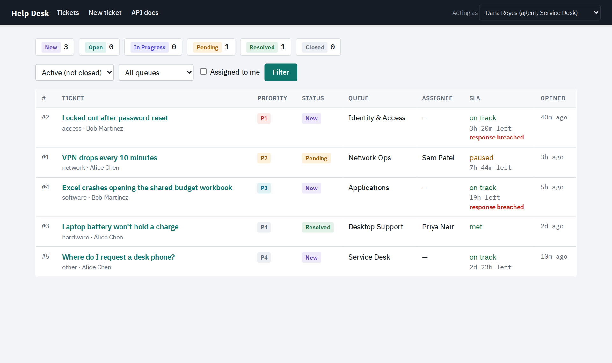
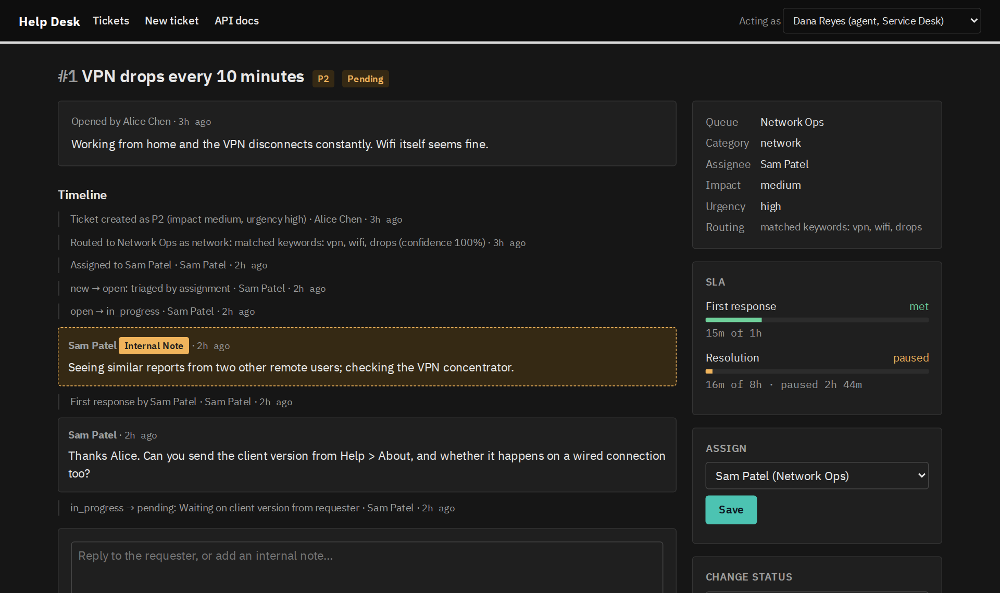
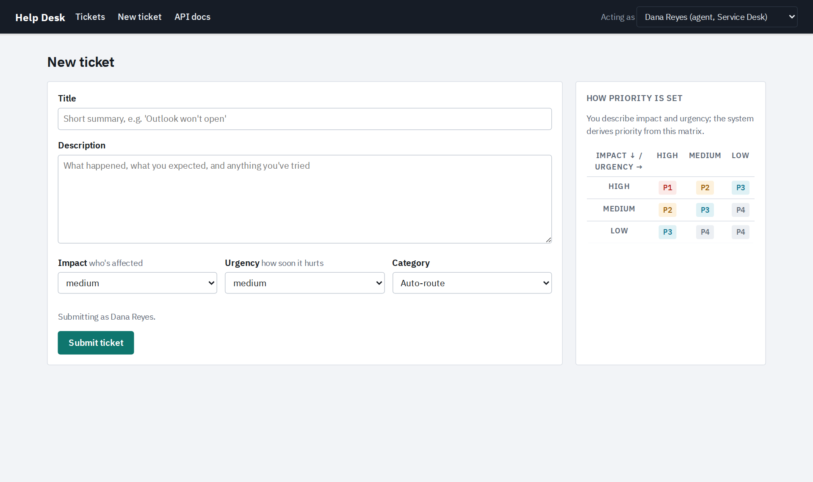

# Help Desk

An IT service desk built with FastAPI and SQLite. It models how real ticketing
systems work: a ticket lifecycle with enforced rules, priority derived from
impact and urgency, SLA clocks that pause while waiting on the customer, team
queues, internal notes, and a full audit trail. Ticket routing sits behind a
small interface so an AI router can be dropped in later and measured against
the rule-based one.



<table>
  <tr>
    <td></td>
    <td></td>
  </tr>
  <tr>
    <td align="center">Ticket detail: audit timeline, internal note, SLA clocks</td>
    <td align="center">New ticket: priority comes from the impact × urgency matrix</td>
  </tr>
</table>

## Quick start

Requires Python 3.10 or newer.

**With [uv](https://docs.astral.sh/uv/)** (recommended; installs the exact versions in `uv.lock`):

```bash
uv sync
uv run uvicorn app.main:app --reload
```

**With pip:**

```bash
python -m venv .venv
.venv\Scripts\activate          # macOS/Linux: source .venv/bin/activate
pip install -r requirements.txt
python -m uvicorn app.main:app --reload
```

Open http://localhost:8000. Interactive API docs are at http://localhost:8000/docs.

The first launch creates demo users and five tickets in different states. Use
the **Acting as** menu (top right) to switch between an agent's view and a
requester's view. There is no real login; that's deliberate for a demo.

| Setting | Default | Effect |
|---|---|---|
| `HELPDESK_DB` | `helpdesk.db` | Path of the SQLite database file |
| `HELPDESK_DEMO` | `1` | Set to `0` to start without demo tickets |

Delete `helpdesk.db` to reset to fresh demo data.

## Tests

```bash
uv run pytest                                            # with uv
pip install -r requirements-dev.txt && python -m pytest  # with pip
```

The rule tests pass a fixed clock into every function, so SLA timing is tested
to the minute (for example, a P1 is on track at 10 minutes, at risk at 12, and
breached at 16). `.github/workflows/ci.yml` runs the same suite against the
oldest and newest supported Python versions.

## What it demonstrates

**Ticket lifecycle as a state machine.** `new → open → in_progress → pending → resolved → closed`,
with only legal moves allowed (`ALLOWED_TRANSITIONS` in `models.py`). Resolving
requires a resolution note. Closing an untriaged ticket (duplicate, spam) requires a reason.
Requesters can only confirm (close) or reject (reopen) a resolution on their own tickets.

**Priority is derived, not chosen.** The requester sets *impact* (how many people
are affected) and *urgency* (how soon it hurts). An ITIL-style matrix turns
that into P1–P4, so "everything is urgent" can't inflate priority.

**Two SLA clocks per ticket.**
- *First response*: time until an agent posts a **public** reply. Internal notes
  don't count, because the SLA measures the customer's wait.
- *Resolution*: time until resolved, **minus time spent in `pending`**. Waiting on
  the requester pauses the clock; the requester replying resumes it automatically.
- States: on track → at risk (75%) → breached, or met / paused / cancelled.
- Pausing stops the clock but never un-breaches a target that was already
  missed, so a ticket can't be parked in `pending` to clear a red SLA.
- A ticket closed without being resolved (duplicate, spam) reports `cancelled`
  on both clocks — it was never work, so it counts neither for nor against.

| Priority | First response | Resolution |
|---|---|---|
| P1 | 15 min | 4 h |
| P2 | 1 h | 8 h |
| P3 | 4 h | 24 h |
| P4 | 8 h | 72 h |

**Routing and queues.** New tickets are routed to a queue by category
(Network Ops, Identity & Access, Desktop Support, Applications). Anything
unmatched goes to the Service Desk triage queue. Assigning a ticket to an
agent in another queue moves it there, and assigning a `new` ticket triages it to `open`.

**Public replies vs. internal notes.** Agents can leave notes that requesters never see.

**Audit trail.** Every change (creation, routing decision, assignment, queue
move, status change, first response) is written to an append-only `events`
table in the same transaction as the change, and shown on the ticket timeline.

## Project layout

```
app/
  models.py     policy: statuses, transitions, priority matrix, SLA targets, schemas
  services.py   business rules; knows nothing about HTTP
  routing.py    Router interface + KeywordRouter baseline
  db.py         SQLite schema and seed users
  seed.py       demo tickets
  main.py       FastAPI: JSON API under /api, HTML pages elsewhere
  templates/    Jinja2 pages (styling tokens live in base.html)
tests/          pytest: business rules + API/UI smoke test
docs/           screenshots
pyproject.toml  dependencies (uv); requirements*.txt are exported from uv.lock
```

The web layer is thin on purpose. Both the JSON API and the HTML forms call the
same functions in `services.py`, so rules are enforced in exactly one place.

## Dependencies

`pyproject.toml` is the source of truth, and `uv.lock` pins every package.
The `requirements*.txt` files are generated from the lockfile for pip users, so
don't edit them by hand. After changing dependencies:

```bash
uv lock
uv export --no-dev --no-hashes -o requirements.txt
uv export --no-hashes -o requirements-dev.txt
```

## Adding AI routing

`routing.py` defines the seam:

```python
class Router(Protocol):
    def route(self, title: str, description: str) -> RoutingDecision: ...
```

Write an `LLMRouter` that returns a `RoutingDecision(category, queue, reason, confidence)`
and set `ROUTER = LLMRouter()` in `main.py`. Some notes for that pass:

- Keep `KeywordRouter` as a **fallback** for when the model errors, times out,
  or returns low confidence. A router must never raise.
- The `reason` and `confidence` are already written to the audit trail, so
  AI decisions stay explainable.
- Keep `KeywordRouter` as a **baseline** too. Measure the AI router against it on a
  labeled set of tickets before claiming an improvement.
- Reassignments to another queue are logged as `queue` events. That's a free
  signal of routing mistakes to evaluate against.

## Known simplifications

- No authentication (the "Acting as" menu stands in for it)
- SLAs use calendar time, not business hours or holidays
- No email-to-ticket, attachments, or notifications
- No database migrations; delete `helpdesk.db` after a schema change
- SQLite with a connection per request; fine for a demo, swap for Postgres at scale

## License

MIT — see [LICENSE](LICENSE).
